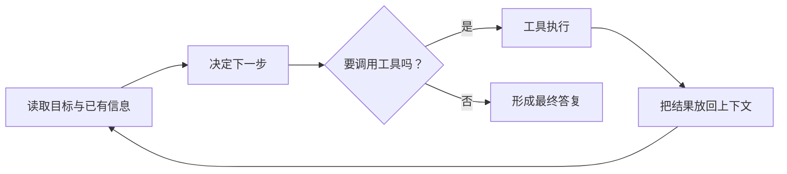

# 第一章：AI Agent 入门——从“模型”到“能做事的系统”

**在总链路中的位置：**本章定义 LLM、上下文与工具怎样构成行动闭环，并引入 Harness 管理整个过程。它是后两章的总框架；后面讨论上下文、记忆、知识库时，都应能放回这张系统图中。

### 1.1 核心模型：Agent = LLM + 上下文 + 工具

这条公式不是说 Agent 只有三个软件模块，而是给出三个不可缺的能力来源：

- **LLM**：理解自然语言、归纳信息、选择下一步行动。
- **上下文**：提供本轮判断所需的输入，包括任务要求、历史、规则和观察结果。
- **工具**：让系统能够查询或改变外部世界，例如搜索数据库、运行代码、读取文件或调用业务 API。

书中用“大脑、眼睛、手脚”作直观比喻：LLM 像大脑，上下文像眼睛，工具像手脚。这个类比帮助记忆，但不要按字面理解：上下文不只负责“看”，它也是模型决策的工作材料；工具也不只是执行动作，读取网页、查询数据库这类“观察”能力同样是工具。

可以用一个熟悉的后端例子来理解：用户说“查一下订单 123 的物流，若已签收就给我摘要”。模型负责理解任务与决定步骤；上下文里有用户请求、权限和之前的结果；订单查询 API 是工具；程序执行 API 后把结果放回上下文，模型再决定如何答复。真正查到订单的是程序工具，不是 LLM 靠语言能力猜出来的。

### 1.2 观察空间、动作空间：Agent 与世界的接口

Agent 不是直接“活在世界里”。它只能通过系统提供的输入渠道获得观察，也只能通过被允许的动作影响外部系统：

- **观察空间**：Agent 能收到的东西，如用户消息、网页内容、数据库结果、图片或程序输出。
- **动作空间**：Agent 被允许采取的动作，如搜索、读取、写文件、下单、发消息。

这就像服务端 API 的输入 DTO 和可调用的业务接口。没有暴露的字段或 API，模型就无法可靠利用它们；暴露得过多，则会增加误用和权限风险。Agent 的能力边界，很大程度上由系统开放了哪些观察和动作决定。

### 1.3 ReAct：让决定与执行形成反馈回路

**ReAct** 可记成“想一步、做一步、看结果，再决定”：

用程序员熟悉的说法，它像一个由模型参与决策的循环控制器。关键不是“让模型多想几遍”，而是每轮都接收真实执行结果。工具失败、返回空数据或得到新证据，都应能影响下一步。

因此，一个合格循环至少要回答：工具调用是否成功？返回结果是什么？是否需要重试或换策略？何时结束？最多允许循环几次？对有副作用的操作是否要人工确认？这些都属于系统工程，而不是单靠提示词解决。

### 1.4 Harness：模型周围的工程控制层

**Harness** 可以先用“Agent 的运行时与控制框架”来理解。它负责把模型接进可运行的流程，并管理模型本身无法保证的事情，例如：

- 上下文如何组装、压缩和更新；
- 工具如何声明、鉴权、执行和回传结果；
- 任务如何停止、重试或恢复；
- 结果如何检查，权限如何限制；
- 何时需要人来审核。

这与 Spring 应用里业务代码之外的 Web 容器、事务、鉴权、异常处理有相似之处：它们不替业务逻辑做判断，却决定业务能否以可控方式运行。这个类比不完全等同于 Harness，但能帮助把它放回熟悉的软件架构里。

书中还把工程重心从单纯 **Prompt Engineering** 推向 **Loop Engineering**：提示词仍然重要，但 Agent 是否可靠，更取决于“模型决定—工具执行—结果观察—校验/恢复”的整个闭环是否设计好。

### 1.5 工作流与自主 Agent：把自由度放在值得的地方

- **工作流**：步骤和分支主要由程序预先规定。适合规则明确、路径稳定、结果可预测的流程。
- **自主 Agent**：模型根据当前观察选择下一步。适合路径不固定、需要探索或需要动态选工具的任务。
- **混合设计**：外层用确定流程保证边界，局部交给 Agent 处理不确定步骤。

一个实用判断法：如果业务规则能清楚写成 `if/else` 或状态机，就先使用常规代码；只有当“下一步取决于尚未确定的信息”时，再把选择权交给模型。自由度越大，越需要校验、预算、超时、权限和人工接管机制。

### 1.6 安全护栏与全书反复出现的设计模式

Agent 的风险来自它能接触数据并调用工具。因而安全应分布在多个位置：输入和上下文处理、工具权限与参数校验、数据访问范围、执行结果验证，以及高风险操作的人类审批。

本书提出的几种贯穿性模式可以记成“如何让变化可控”：

- **提议者—审核者**：提出改动的组件与检查证据的组件分开。
- **渐进式披露**：先给轻量目录，需要时再读完整内容。
- **只追加原始记录**：保留事实来源，避免改写后无从追溯。
- **边界集与保留集**：既说明希望改变什么，也说明哪些性质绝不能被破坏。
- **最小差异与回滚**：一次只改必要部分，保留恢复路径。

它们不是 Agent 独有的魔法，和代码审查、日志审计、最小权限、灰度发布这些成熟工程实践有共同思想：让自动化可以检查、追溯和撤销。

---
