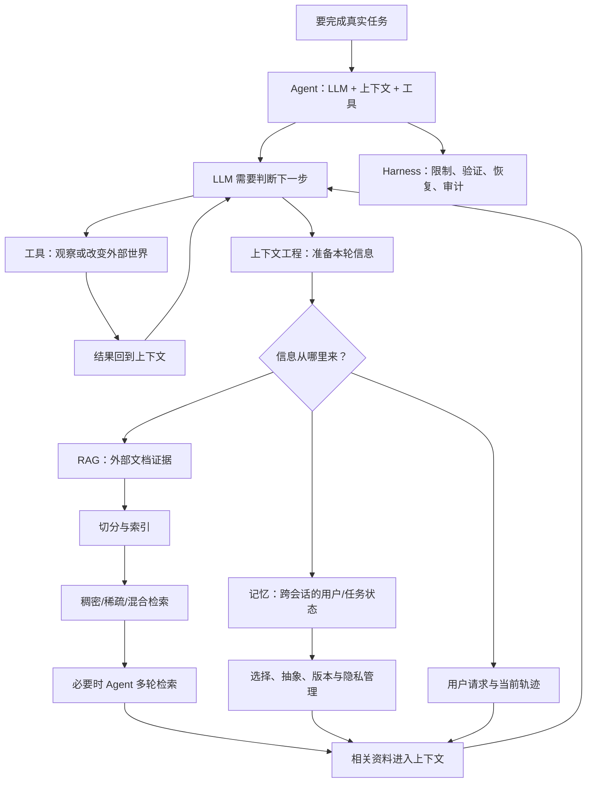

# 《深入理解 AI Agent：设计原理与工程实践》

## 第三章：用户记忆和知识库——把“当前看不到的信息”找回来

**在总链路中的位置：**本章向上游延伸，研究上下文所需信息如何被抽取、保存、组织、检索和更新。最终目标仍是把相关信息送入第二章所说的当前上下文，供第一章的 Agent 循环使用。

第二章管理的是眼前工作台，但有些信息来自过去，有些散落在文件里。第三章因此把信息系统分成两条相邻但不同的路径：**记忆管理人和任务的持续状态；RAG 从外部资料中按需找证据。** 两者最后都会把相关内容送入当前上下文。

### 3.1 用户记忆：从经历中保存有用状态

记忆不是把所有对话永久塞回提示词。它要经过选择、抽象、结构化和更新。例如一次性的“今天想喝咖啡”一般不该变成长期偏好；多次表达的稳定偏好可能值得保留，但仍要允许用户纠正。

书中讨论的不同表示形式可以这样理解：

- **简单事实**：像便签，短而便宜，适合清晰、独立的信息；复杂关系和语境容易丢。
- **自然语言摘要**：像交接说明，保留上下文较自然，但可能重复、难以局部更新。
- **JSON 卡片**：像有字段的数据库记录，便于检索和更新，但类别设计不合适时会僵硬。
- **扩展 JSON 卡片**：补充人物背景和关系，有利于消歧和关系推理，但维护成本更高。

选择格式不是追求最复杂，而是看查询任务需要什么。只回答“用户喜欢什么饮料”，简单事实可能够用；回答“为什么用户把计划 A 改为计划 B”，就需要保留事件、条件、时间和因果语境，过度压成标签会丢掉关键含义。

### 3.2 记忆的层次、类型和更新

可以把记忆分为原始轨迹、提炼后的长期记忆和当前业务状态。原始轨迹利于审计；长期记忆利于跨会话使用；当前状态利于继续手头任务。三者的更新规则不同，不要把“压缩当前上下文”误当成“可以删除来源记录”。

书中借用认知科学的分类作理解框架：工作记忆服务当前任务，情景记忆记录经历，语义记忆保存相对稳定的事实，程序性记忆保存可复用的做事方式。实现上，这些类型可能分布于不同文件、数据库字段或服务，不必机械地建立四张表。

记忆会过时和冲突，所以要考虑频率、时效、重要性、来源与适用条件。隐私信息还要有访问控制和日志脱敏。尤其在高风险场景，模型对记忆的归纳应当可检查、可修正，不宜把推断当成用户明确说过的事实。

### 3.3 RAG：为当前问题找回外部证据

RAG（Retrieval-Augmented Generation，检索增强生成）的直觉可以用“开卷考试”理解：

1. 把资料整理成可检索的形式；
2. 用户提问时先找出相关资料；
3. 把资料片段连同问题交给模型；
4. 模型基于这些材料组织答案，最好还能指出依据。

模型参数里的通用知识像“平时学过的内容”；RAG 像考试时允许翻阅的指定资料。它适合加入模型未见过、不断更新或需要出处的信息，但不保证答案自动正确：切分错、索引漏、检索不准、来源过时或模型误读，都能导致错误。

### 3.4 文档切分：检索系统的“货架标签”

向量模型和检索器通常不会直接把一本长书当作一个整体精确定位，所以需要把文档切成片段（chunk）。切得太大，检索结果可能把无关段落一起带来；切得太小，则定义、条件或上下文可能被切断。

这有点像把一本技术手册拆成可取用的资料卡：每张卡太长就难以快速定位，太短又可能只剩一个术语，没有解释。按标题、段落和语义边界切分通常比纯粹按固定字符数更保留结构，但具体方案应使用真实问题检验，而不是把某个 token 数当成通用标准。

### 3.5 稠密检索、稀疏检索与混合检索

两类基础检索可以用“找意思”和“找字面”来区分：

- **稠密向量检索**：把文本映射为向量，按语义相似度找资料。用户说“怎样取消服务”，文档写“注销订阅”，表达不同但意思相近，向量检索有机会找到。
- **稀疏检索**：依赖关键词和倒排索引等精确匹配机制。搜索 `ERR_CONN_RESET`、订单号、类名或产品型号时，字面匹配往往非常重要。
- **混合检索**：先用两种方式找候选，再融合或重排。语义召回和精确词项互补，但也需要评测和调参。

可以类比数据库查询：语义向量更像“按相似内容找”，关键词检索更像“按索引字段匹配”。二者不是谁替代谁，而是适合的查询特征不同。通过 Recall@K、MRR、nDCG 等指标和人工检查，可以评估候选片段是否找全、是否排在前面。

### 3.6 从文本块到更有结构的知识

当普通混合检索无法满足复杂问题，才考虑更复杂的组织方式：

- **RAPTOR**：把片段逐层聚合和概括，像先看章节摘要，再进入具体段落。适合“从总体架构逐步找到细节”一类问题。
- **GraphRAG / 知识图谱**：显式保存实体及其关系，像从关系网中追踪“谁影响谁、A 和 B 有什么联系”。但把自然语言抽成三元组，可能丢掉条件、时间和语气，也会引入抽取错误。
- **文件系统式知识库**：将知识放入可浏览的目录和文件，先读摘要/概览，需要时读全文；配合索引和链接，便于人检查、修改和版本控制。

这三者不是“越新越应该用”。如果用户主要问“某项政策是什么”，切分加混合检索可能已经足够；如果经常问跨文档、多层次或实体关系问题，再评估结构化索引。更复杂通常意味着更多构建步骤、模型调用、延迟和维护责任。

### 3.7 知识更新：把知识库当成需要审查的代码库

知识会新增、变更、过期和冲突。书中提出两种互补节奏：

- **增量更新**：新证据到来时，局部提出变更；
- **周期整理**：从整体上做去重、过期检查、冲突处理和目录调整。

一个很适合开发者记忆的类比是：把原始资料当源数据，把审核后的 Markdown/结构化知识当源代码，把向量索引当构建产物。知识变更可像 Git PR 一样审查，索引在批准后重建；不要让模型悄悄改线上知识并且无法回滚。

检索还要在检索阶段执行权限过滤。若用户无权看到的内容已经进入模型上下文，之后再要求模型“不泄露”并不能可靠补救。更新和检索不仅是搜索效果问题，也是来源、版本、租户隔离和权限边界问题。

### 3.8 Agentic RAG：从“自动检索管道”到“Agent 会使用搜索工具”

传统 RAG 往往是固定步骤：用户提问 → 检索一次 → 把结果交给模型回答。**Agentic RAG** 则把检索能力做成 Agent 可调用的工具，让它可以先分析问题、搜索、检查结果是否充分，不够时再调整查询或继续找。

用书中的研究员类比：传统 RAG 像规定只能查一次目录就写报告；Agentic RAG 像研究员可以查不同资料、核对证据，再决定材料够不够。优势是可以处理需要分解的问题；代价是更多模型调用、时延、费用和错误路径。因此，若一次检索能稳定解决问题，就没必要为了“Agent 化”而增加循环。

Agentic RAG 也把 RAG 安全问题放大了：文档中的恶意内容可能是间接提示注入。检索到的文字应被当作**待引用的数据**，不是更高优先级的指令；搜索结果也不能单独授权发信、删除、转账等有副作用操作。模型是否继续搜索，与业务权限是否允许执行，是两道不同的判断。

---

## 把知识点连成一张“因果网”

这张图可用来定位读书时的困惑：

- 不知道 Agent 为什么要循环：回到 **反馈闭环**；
- 不知道提示词为什么效果不稳定：检查 **上下文有没有关键材料**；
- 不知道记忆和 RAG 的边界：看信息来自 **用户/任务状态** 还是 **外部文档**；
- 不知道要不要上 GraphRAG：先判断普通检索是否能回答实际问题；
- 不知道安全措施该放哪里：优先在 **工具执行、检索权限和数据来源** 等系统边界落实，而不只写进提示词。

---

## 与熟悉的软件工程做一次映射

| AI Agent 概念 | 可先借用的后端工程直觉              | 需要补上的差异               |
| ----------- | ------------------------ | --------------------- |
| Agent 循环    | 控制器 + 状态机/循环             | 下一步可由概率模型选择，结果不完全确定   |
| 工具调用        | 调用服务/API/命令              | 模型只提出调用，宿主程序负责校验与执行   |
| 上下文         | 单次请求的 DTO、局部执行状态         | 组织方式和长度直接影响模型行为与成本    |
| 记忆          | 用户档案、业务状态、审计轨迹           | 内容需从对话中提取，可能含推断、过期或冲突 |
| RAG         | 搜索服务 + 文档索引              | 召回质量、片段边界和模型引用都需单独评估  |
| Harness     | Web 框架、中间件、事务/权限/异常机制的组合 | 还要管理模型循环、上下文和不确定性     |
| 知识审核流程      | Git 分支、PR、CI、发布索引        | 自动提炼可能误读证据，需要回到原始来源审核 |

这些映射是帮助建立直觉，不代表两边概念严格等价。尤其不要把 Agent 理解成“一个普通微服务里多调了几次模型”：模型会选择动作，而程序系统仍必须掌握权限、状态和最终执行权。

---

## 读完这部分后，应该能回答的问题

尝试不看正文，用自己的话回答。答不出来的点就是下一轮值得回看的“检索入口”。

1. 为什么 Agent 不是“LLM 加几个提示词”？一个完整的行动反馈循环是什么？
2. 工具调用中，模型、宿主程序和工具分别负责什么？
3. 什么情况下应优先用确定性工作流，什么情况下才值得引入自主 Agent？
4. 为什么 API 每轮都要提供上下文？上下文和长期记忆有什么区别？
5. 工具结果、状态摘要和检索资料分别怎样影响下一次模型决策？
6. 为什么稠密检索与关键词检索可能要组合？各自容易在哪些查询上失手？
7. 普通 RAG 和 Agentic RAG 的控制权差异是什么？后者新增了什么成本和风险？
8. 为什么知识库更新应能追溯、审查和回滚？向量索引与已审核知识的关系是什么？
9. 为什么提示词中的安全约束不能代替工具权限校验和检索权限过滤？

### 推荐的口头复述模板

> Agent 为了完成任务，需要模型、当前信息和外部行动能力。模型每次只看到系统提供的上下文，因此工程重点是构建好决策—工具—观察闭环。上下文只解决当前决策的信息问题；跨任务的用户状态靠记忆，外部文档靠 RAG。检索结果进入上下文之后才被模型使用；Harness 则贯穿整个流程，负责限制权限、验证结果、管理失败和风险。

如果能自然讲清这段，并能给每一项举一个自己熟悉的后端例子，前三章的主逻辑就基本连起来了。

---

## 面向实操：用一个小项目把前 102 页串起来

建议做一个**本地技术文档问答 Agent**，先不追求复杂框架：

1. 用 FastAPI 提供一个提问接口；
2. 先实现文档读取、按标题/段落切分和普通关键词搜索；
3. 加向量检索，比较它与关键词搜索的差异；
4. 将检索封装成工具，让模型能查看来源片段并引用；
5. 再允许模型在证据不足时调整查询、再次搜索；
6. 用一组固定问题检查召回和答案来源；
7. 给知识文件加来源、版本或日期元数据，模拟更新和下架；
8. 最后才加一份很小的用户偏好记忆，并测试更新与冲突。

这个项目能把三章主线逐项映射到代码：FastAPI 是宿主程序；LLM 做判断和生成；上下文是每轮传入的材料；搜索是工具；文档索引是 RAG；循环是 Agent 行为；来源、权限、超时和结果检查属于 Harness。先做一次检索，再升级为迭代检索，能清楚看到复杂度是为了解决什么问题。

**项目验收不应只看“能回答”**，至少记录：检索到的片段及来源、是否命中预期证据、回答是否被来源支持、错误/无结果时如何处理，以及工具调用次数。这样能区分是检索失败、上下文组织问题，还是模型生成问题。

---

## 学习时的边界提醒

本笔记中的图示、后端类比和项目建议是为了帮助理解而补充的解释；书里的术语和章节内容以原书为准。缓存机制、各框架特性和模型 API 会随产品迭代变化，实际实现时应以所用服务的当前文档为准。RAPTOR、GraphRAG、Agentic RAG 等结构也不是默认必选项，应由问题类型和评测结果决定。
